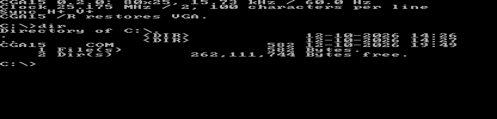

# CGA timing (CGA15)

DOS program that reprograms a standard VGA card to 80x25 text with CGA timing: 15.73 kHz horizontal, 60.0 Hz vertical, 200 visible lines. Meant for feeding a CGA monitor or a 15 kHz video converter (e.g. the MCE Blaster) from a VGA card without a CGA emulation.

> **Untested on real hardware.** Only tested in DOSBox. Connect a CGA monitor only after checking the frequency with a converter or scope: a wrong line frequency can damage old monitors.

## Usage

```
CGA15       switch to 80x25 at 15.7 kHz
CGA15 /R    back to normal VGA mode 3
```

Diagnostic switches (combinable) for finding out why a card or output shows no sync:

| Switch | Effect |
|---|---|
| `/N` | no clock halving: 25.175 MHz, 200 characters per line. Same 15.73 kHz, but the picture fills only the left part of the line |
| `/P` | sync polarity as VGA mode 3 (H negative, V positive) instead of CGA (both positive) |
| `/K` | change the clock without the sequencer reset |



*Screenshot taken in DOSBox (the wider image is DOSBox showing part of the blanking area).*

## How it works

Only standard VGA registers are used, so it should work on any register-compatible VGA card.

| Setting | Value |
|---|---|
| Clock | 25.175 MHz (Misc 23h), halved by the sequencer (index 01h = 09h) → 12.59 MHz pixel clock |
| Characters | 8 dots wide, 100 per line, 80 visible → 800 pixels → 15.73 kHz |
| Lines | 262 per frame, 200 visible → 60.0 Hz |
| Font | 8x8 ROM font (`INT 10h AX=1112h`) |
| Sync | positive horizontal and vertical sync |

The output is still analog RGB on the VGA connector. A CGA monitor needs a digital TTL RGBI signal, so an RGB-to-RGBI converter or a 15 kHz-capable analog monitor is required. Programs that set their own video mode undo the timing.

## Building

```sh
make    # needs nasm, produces bin/CGA15.COM
```

A ready-made `CGA15.COM` is attached to the GitHub releases (tag `cga_timing-v*`) and to every CI run as a build artifact. Runs on an 8088 CPU, uses 8086 instructions only.

## License

[MIT](../LICENSE)

## AI disclosure

Program and documentation were created with the help of AI (Claude, Anthropic). So far tested in DOSBox only, not on real hardware.
