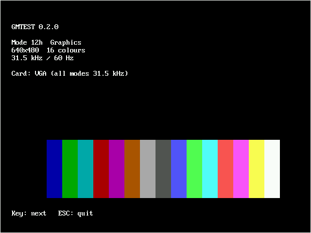

# Graphic Mode Tester (GMTEST)

DOS program for the IBM PC/XT/AT that shows every video mode of the installed graphics card one after another, each with a static test image. Meant for checking graphics cards, monitors and video converters (e.g. the MCE Blaster).

## Test image

For each mode:

- white border along the screen edge (1 pixel, or a double line in text modes)
- mode number, resolution, colours
- horizontal and vertical frequency (static values from a table, not measured)
- detected card
- colour bars with every colour of the mode

Controls: any key = next mode, `ESC` = quit (the previous mode is restored).

| CGA mode 03h | CGA mode 04h | CGA mode 06h |
|---|---|---|
|  |  |  |
| **EGA mode 0Dh** | **EGA mode 10h** | **MDA mode 07h** |
|  |  |  |
| **VGA mode 12h** | | |
|  | | |

*Screenshots taken in DOSBox.*

## Modes

| Card | Modes |
|---|---|
| MDA / Hercules | 07h |
| CGA | 00h–06h |
| EGA with CGA monitor | 00h–06h, 0Dh, 0Eh |
| EGA with EGA monitor | 00h–06h (text with 350 lines), 0Dh, 0Eh, 10h |
| EGA with mono monitor | 07h, 0Fh |
| VGA | 00h–06h, 0Dh, 0Eh, 10h, 12h |

| Mode | Resolution | Frequency |
|---|---|---|
| 00h–06h, 0Dh, 0Eh | 320/640 × 200 | 15.7 kHz / 60 Hz |
| 00h–03h on EGA monitor, 10h | 320/640 × 350 | 21.8 kHz / 60 Hz |
| 07h, 0Fh | 720/640 × 350 | 18.4 kHz / 50 Hz |
| VGA: all modes except 12h (200-line modes double scanned) | up to 720 × 400 | 31.5 kHz / 70 Hz |
| VGA: 12h | 640 × 480 | 31.5 kHz / 60 Hz |

Detection: EGA via `INT 10h AH=12h`, monitor type via the EGA card's DIP switches (0011/1001 = EGA monitor), otherwise MDA/CGA via the equipment word (`INT 11h`). A VGA card is detected via `INT 10h AX=1A00h`. It runs every mode at 31.5 kHz, so GMTEST cannot produce CGA/EGA timing on a VGA card: that needs the card's own emulation (DIP switches) or `CGA15`.

## Building

```sh
make              # needs nasm, produces bin/GMTEST.COM
make screenshots  # optional: screenshots in DOSBox (dosbox, Xvfb, xdotool, imagemagick)
```

A ready-made `GMTEST.COM` is attached to the GitHub releases (tag `graphic_mode_tester-v*`) and to every CI run as a build artifact. Runs on an 8088, uses 8086 instructions only.

## License

[MIT](../LICENSE)

## AI disclosure

Program and documentation were created with the help of AI (Claude, Anthropic). So far tested in DOSBox only (CGA, EGA, VGA, Hercules), not on real hardware.
