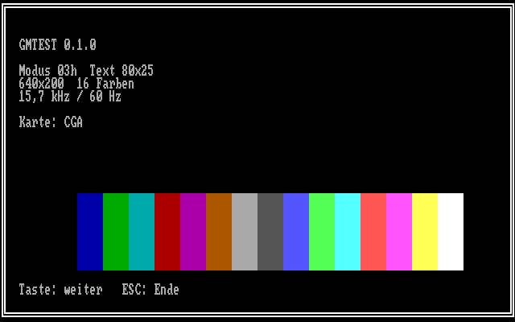
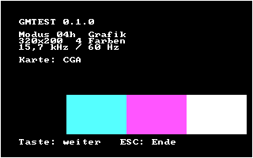
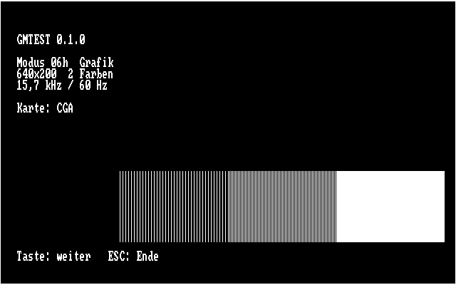
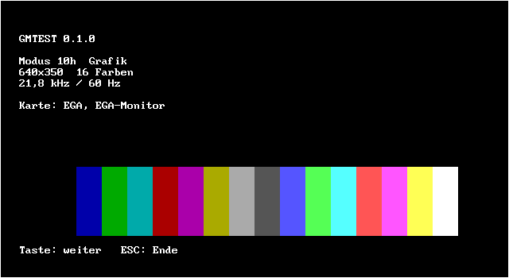
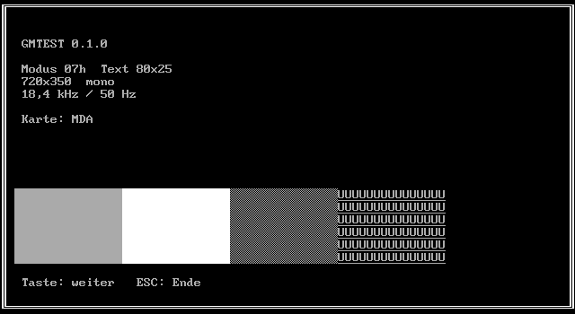

# Graphic Mode Tester (GMTEST)

DOS-Programm für IBM PC/XT/AT, das alle Videomodi der eingebauten Grafikkarte nacheinander mit einem statischen Testbild anzeigt. Gedacht zum Prüfen von Grafikkarten, Monitoren und Video-Konvertern (z. B. MCE Blaster).

## Testbild

Pro Modus:

- weißer Rahmen am Bildrand (1 Pixel bzw. Doppellinie im Textmodus)
- Modusnummer, Auflösung, Farben
- Zeilen- und Bildfrequenz (statisch aus Tabelle, nicht gemessen)
- erkannte Karte
- Farbbalken mit allen Farben des Modus

Bedienung: beliebige Taste = nächster Modus, `ESC` = Ende (alter Modus wird wiederhergestellt).

| CGA Modus 03h | CGA Modus 04h | CGA Modus 06h |
|---|---|---|
|  |  |  |
| **EGA Modus 0Dh** | **EGA Modus 10h** | **MDA Modus 07h** |
|  |  |  |

*Screenshots aus DOSBox.*

## Modi

| Karte | Modi |
|---|---|
| MDA / Hercules | 07h |
| CGA | 00h–06h |
| EGA mit CGA-Monitor | 00h–06h, 0Dh, 0Eh |
| EGA mit EGA-Monitor | 00h–06h (Text mit 350 Zeilen), 0Dh, 0Eh, 10h |
| EGA mit Mono-Monitor | 07h, 0Fh |

| Modus | Auflösung | Frequenz |
|---|---|---|
| 00h–06h, 0Dh, 0Eh | 320/640 × 200 | 15,7 kHz / 60 Hz |
| 00h–03h auf EGA-Monitor, 10h | 320/640 × 350 | 21,8 kHz / 60 Hz |
| 07h, 0Fh | 720/640 × 350 | 18,4 kHz / 50 Hz |

Erkennung: EGA über `INT 10h AH=12h`, Monitor über die DIP-Schalter der EGA-Karte (Schalter 0011/1001 = EGA-Monitor), sonst MDA/CGA über das Equipment-Wort (`INT 11h`). Eine VGA-Karte meldet sich als EGA mit EGA-Monitor.

## Bauen

```sh
make            # braucht nasm, erzeugt bin/GMTEST.COM
make screenshots  # optional: Screenshots in DOSBox (dosbox, Xvfb, xdotool, imagemagick)
```

Fertige `GMTEST.COM` liegt in den GitHub-Releases (Tag `graphic_mode_tester-v*`) und als Build-Artefakt jeder CI-Ausführung. Läuft auf 8088, nur 8086-Befehle.

## Lizenz

[MIT](../LICENSE)

## AI disclosure

Programm und Dokumentation wurden mit Unterstützung von KI (Claude, Anthropic) erstellt. Getestet bisher nur in DOSBox (CGA, EGA, Hercules), nicht auf echter Hardware.
