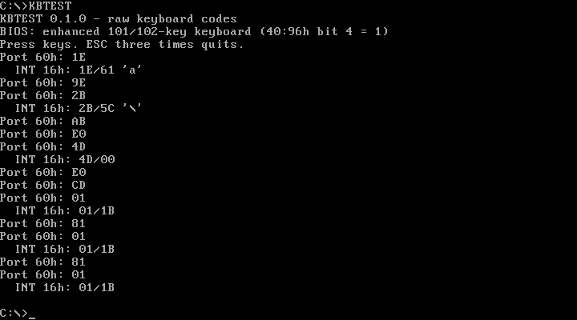

# Keyboard test (KBTEST, ENHKB)

DOS program that shows, for every key, the raw bytes the keyboard (or an AT-to-XT converter) delivers on port 60h and the scan code / ASCII pair the BIOS returns via `INT 16h`. It also shows whether the BIOS reports an enhanced 101/102-key keyboard (BIOS data area 40:96h bit 4), which keyboard drivers such as `KEYB GR` need for AltGr and the `<>` key.

```
KBTEST    press keys, ESC three times in a row quits
```



*Screenshot taken in DOSBox: `a`, `\`, cursor right (E0 prefix), ESC.*

Expected raw codes (scan code set 1) for the keys that matter on a German keyboard:

| Key | Make | Break |
|---|---|---|
| `<>` (102nd key) | 56 | D6 |
| `#'` | 2B | AB |
| AltGr | E0 38 | E0 B8 |
| `ß` | 0C | 8C |

A converter that drops the E0 prefix makes AltGr look like the left Alt key; one that maps the 102nd key to 2B makes `<>` look like `#`/`\`.

The program hooks `INT 09h` in front of any keyboard driver already loaded, so it shows the bytes before `KEYB` translates them.

## ENHKB

Sets bit 4 of 40:96h (enhanced keyboard installed) so that `KEYB` uses its 102-key table even when the BIOS reports an 83/84-key keyboard. Run it in `AUTOEXEC.BAT` before `KEYB`:

```
ENHKB
KEYB GR,437,C:\DOS\KEYBOARD.SYS
```

`ENHKB /U` clears the flag again.

Found with KBTEST on a Micro 8088 with an AT-to-XT converter (2026-10-12): the `<>` key correctly sends 56h, but the BIOS reports an 83/84-key keyboard, so `KEYB GR` ignores the key and the BIOS turns it into `\`. The converter drops the E0 prefix, so AltGr arrives as left Alt (38h). With ENHKB, `<>` should work; whether `\` then comes with Ctrl+Alt+ß or Alt+ß depends on the KEYB version (untested).

## Building

```sh
make    # needs nasm, produces bin/KBTEST.COM and bin/ENHKB.COM
```

Ready-made `KBTEST.COM` and `ENHKB.COM` are attached to the GitHub releases (tag `keyboard_test-v*`) and to every CI run as a build artifact. Runs on an 8088, uses 8086 instructions only.

## License

[MIT](../LICENSE)

## AI disclosure

Program and documentation were created with the help of AI (Claude, Anthropic). So far tested in DOSBox only.
