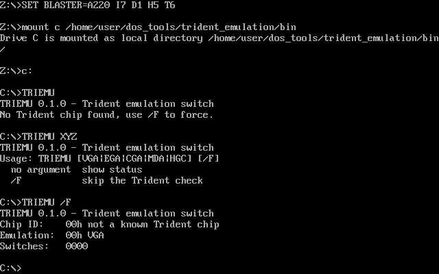

# Trident emulation switch (TRIEMU)

> ⚠️ **Untested on real hardware.** Written from the register documentation only. Use at your own risk and report results.

Small DOS tool that switches the emulation mode of a Trident TVGA8800/8900 graphics card. Replacement for Trident's `SVM.EXE` (folder `TVGAUTIL` on the driver disk), which is hard to find for the 8800BR. Goal: get real CGA/MDA timing out of the card's 9-pin TTL output, e.g. for testing the MCE Blaster. Runs on DOS 2.0 and later (e.g. DOS 3.31, where `MODE MONO` is not available).

## Usage

```
TRIEMU            show chip ID, emulation and switch settings
TRIEMU VGA        back to VGA, BIOS mode 3
TRIEMU EGA        EGA emulation, BIOS mode 3
TRIEMU CGA        CGA emulation, 80x25 text programmed like an IBM CGA
TRIEMU MDA        MDA emulation, 80x25 text programmed like an IBM MDA
TRIEMU HGC        same as MDA
/F                skip the Trident check
```

On the card, also set the output to TTL (jumper/DIP switches per the card's manual).

## How it works

| Step | Register (TRIDENT.TXT) |
|---|---|
| Detect chip | 3C4h index 0Bh: write 0 selects old mode registers, read returns the chip ID (01h = TVGA8800BR) |
| Switch emulation | 3C4h index 0Dh (old mode control 2), bits 0–2: 0 = VGA, 3 = EGA, 5 = CGA/MDA/Hercules |
| Switch settings | 3C4h index 0Fh, bits 0–3 |

For `CGA` and `MDA` the tool first sets the matching VGA BIOS mode (font, palette), clears the VGA CRTC write protect, switches the emulation, then writes the 6845 registers, the mode register (3D8h/3B8h) and the BIOS data area with the values of the original IBM BIOS:

| | 6845 R0–R11 | Mode reg. |
|---|---|---|
| CGA 80x25 | 71 50 5A 0A 1F 06 19 1C 02 07 06 07 | 29h, colour 30h |
| MDA 80x25 | 61 50 52 0F 19 06 19 19 02 0D 0B 0C | 29h |

Open: whether the 8800BR in emulation mode 5 really takes over the 6845 values as 15.7 kHz / 18.4 kHz timing, and whether `EGA` changes the timing at all, is not known.

Source: [vgadoc TRIDENT.TXT](https://pdos.csail.mit.edu/6.1810/2017/readings/hardware/vgadoc/TRIDENT.TXT)

## Tested

| Where | Result |
|---|---|
| DOSBox (S3, CGA, Hercules) | argument parsing, status output, CGA/MDA register programming keep a working text screen |
| Trident TVGA8800BR | **not yet tested** |



## Building

```sh
make   # needs nasm, produces bin/TRIEMU.COM
```

A ready-made `TRIEMU.COM` is attached to the GitHub releases (tag `trident_emulation-v*`) and to every CI run as a build artifact. 8086 instructions only.

## License

[MIT](../LICENSE)

## AI disclosure

Program and documentation were created with the help of AI (Claude, Anthropic).
